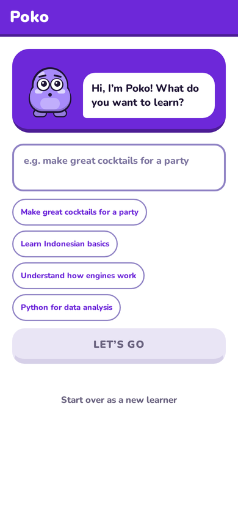
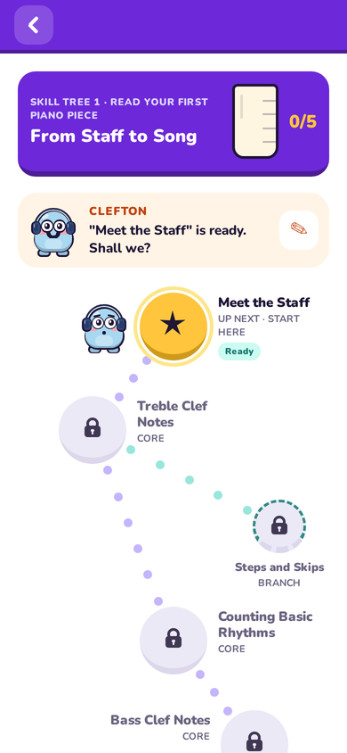
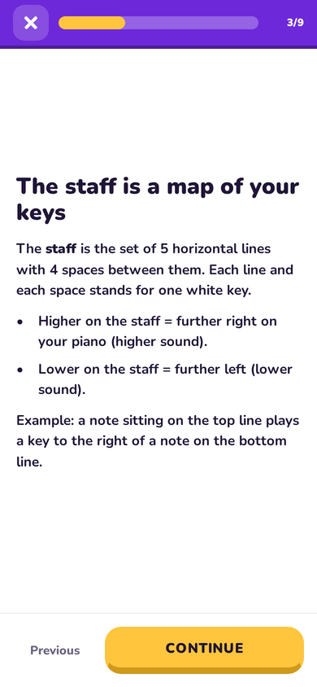
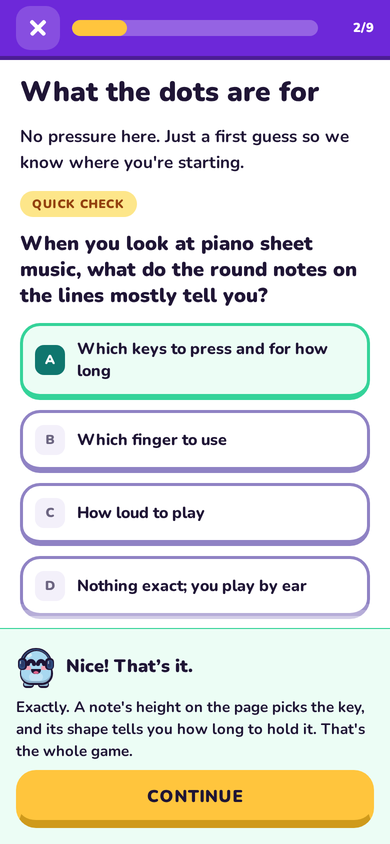
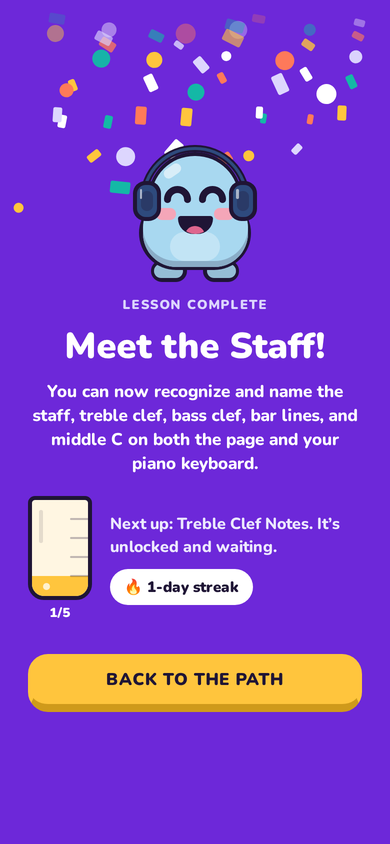

<p align="center">
  
</p>

<h1 align="center">Poko: Learn Anything</h1>

<p align="center"><em>Poco a poco. Learn anything.</em></p>

<p align="center">
  <a href="LICENSE"></a>
  
  
  
</p>

Tell Poko what you want to learn and why. A short chat gathers only the context that matters, and Poko builds you a personal course: a winding skill path of short lessons, each played as interactive slides, with checks that teach when you get something wrong.

Poko runs on iOS, Android and the web from one Expo codebase. A small API server in this repository talks to Claude, validates everything the model returns, and stores progress in SQLite.

<p align="center">
  
  
  
  
  
</p>

## Features

- **Any goal, for a real reason.** Goal Screening turns away illegal or harmful goals before anything is planned, and Poko says why.
- **A short intake.** At most four questions, with quick answers to tap.
- **A personal skill path.** Required lessons wind down the page and optional side branches dead-end beside them. Locked, available and done states are derived from your completions, never stored.
- **Lessons as interactive slides.** Nine components: text, callout, ratio bar, diagram, checklist, multiple choice, code block, fill in the blank and match pairs.
- **Wrong answers teach.** Answers are scored by code, every miss explains the idea, and you can retry or come back later.
- **Small, friendly incentives.** A streak, celebrations and a glass that fills as you go. No points, lives or leaderboards.
- **Room to grow.** Keep going with a new skill tree, explore something different, or start from a course another learner built.
- **A companion per course.** Each course gets a Poko with its own name and costume, which you can rename or re-roll.
- **Installable on the web.** Add it to an iPhone Home Screen and it runs full screen with its own icon.

## How it works

- **Contracts at every boundary.** Every model output is requested as structured output against a Zod contract in `src/contracts` and validated with that same contract before it is stored or shown. Slides are typed JSON from a closed catalog. No generated HTML, markup or code runs anywhere.
- **Only the server holds the key.** The Expo app talks to the API server, and the server is the only process that talks to Anthropic.
- **Claude where it helps, code where it must be right.** Lesson planning and writing use `claude-opus-5-5` with adaptive thinking. Goal Screening uses `claude-haiku-5-5` and fails closed. Scoring, progression, completion and streaks are pure functions in `src/domain`, shared by client and server.
- **Plan early, write on demand.** A course plan is made when the course is created. Each lesson is written when its node is opened or predicted next, using what you have done since.

The full picture is in [docs/architecture.md](docs/architecture.md), with decisions in [docs/decisions](docs/decisions/) and the vocabulary in [CONTEXT.md](CONTEXT.md).

## Getting started

You need Node 24 LTS and an [Anthropic API key](https://console.anthropic.com/). The key stays on the server.

```sh
git clone https://github.com/tylercyert/indy-learning-app.git poko
cd poko
npm ci
cp server/.env.example server/.env      # set ANTHROPIC_API_KEY
cp .env.example .env.local              # EXPO_PUBLIC_API_URL: where the app can reach the server
npm run server:dev                      # API on http://localhost:8787
npm run web                             # or: npm start, then scan the QR code with Expo Go
```

Server settings in `server/.env`: `ANTHROPIC_API_KEY`, `PORT` (8787), `DATABASE_PATH` (`./data/poko.sqlite`), `ALLOW_NO_AI=1` to boot without a key (generation routes return 503), and `ANTHROPIC_FAST_MODE=0` to turn off Anthropic fast mode.

**Self-hosting the web app.** `npm run serve` exports the web app and serves it from the API server on one origin, on port 8787 of every interface. Open it on a phone on the same network, then use Share, "Add to Home Screen".

**Native builds.** Identifiers, icons and the splash screen are configured in `app.json` (`com.tylercyert.poko`). Builds run locally with Expo's native tooling:

```sh
npx expo prebuild          # generates ios/ and android/ (gitignored)
npx expo run:ios           # needs a Mac with Xcode
npx expo run:android       # needs Android Studio and an SDK
```

Set `EXPO_PUBLIC_API_URL` to an address the device can reach before building. Release builds need that URL to be HTTPS, because iOS App Transport Security and Android's cleartext rules block plain HTTP.

## Scripts

| Script | What it does |
|---|---|
| `npm start` / `npm run web` / `ios` / `android` | Expo dev server (Metro), optionally opening a platform |
| `npm run start:tailscale` | Metro on :8081 advertised on this machine's Tailscale IP, for Expo Go on phones |
| `npm run server:dev` / `server:start` | API server with reload / without |
| `npm run web:export` | `expo export --platform web` into `dist/`, which the API server serves at `/` |
| `npm run serve` | web export, then the API server on 0.0.0.0:8787 serving the app and the API |
| `npm run verify` | `tsc --noEmit`, `eslint --max-warnings=0`, `vitest run` |
| `npm run test` / `test:watch` | vitest once / watching |
| `npm run export:all` | Metro bundles for iOS, Android and web (bundling only, not a device test) |
| `npm run db:generate` / `db:studio` | Drizzle migration generation / Drizzle Studio |
| `npm run smoke` | live end-to-end check against the real API (`server/scripts/smoke.ts`; spends tokens) |
| `npm run qa:journey [goal]` | headless Playwright journey with screenshots in `qa/out/` (needs the server; spends tokens) |
| `npm run qa:slides` | renders the stress fixtures in `qa/fixtures/stress/` through `/dev/slide` |

Also run with `npx tsx`: `server/scripts/screen-smoke.ts` (Goal Screening), `qa/discover.ts`, `qa/explore.ts`, `qa/a11y/audit.ts` (axe-core + keyboard), `qa/shot-pwa.ts` (Home Screen shell on phone sizes), `qa/render-icons.ts` (web and native icons and the splash image, drawn from the Poko companion), `qa/fixtures/stress/generate.ts`.

## Project layout

- `app/`: Expo Router file routes
- `src/contracts/`: Zod contracts shared by client and server; types inferred, never copied
- `src/domain/`: pure rules: progression, scoring, completion, streak
- `src/features/`: screens and component renderers
- `src/services/`: the API client
- `server/src/`: Hono routes, services, the only model caller (`ai/`), Drizzle + SQLite (`db/`)
- `server/drizzle/`: generated SQL migrations
- `server/scripts/`: live smoke checks (full loop, Goal Screening)
- `qa/`: headless visual and accessibility QA drivers and stress fixtures; outputs in gitignored `qa/out/`
- `assets/`, `public/`: native icons and splash; web manifest and icons
- `docs/`: product, architecture, decisions, plans and history

## Quality

- `npm run verify` runs the typecheck, lint with zero warnings and the unit tests. It must pass on every change.
- `npm run qa:journey` drives a full learner journey headlessly against a running server and saves screenshots.
- `npx tsx qa/a11y/audit.ts` runs axe-core plus keyboard passes. `npm run qa:slides` renders stress fixtures for every component.
- Not yet verified: native builds on real devices, VoiceOver and TalkBack. Device QA is tracked in [#9](https://github.com/tylercyert/indy-learning-app/issues/9).

## Contributing

Issues and pull requests are welcome. Read [CONTRIBUTING.md](CONTRIBUTING.md) first, and report security problems as described in [SECURITY.md](SECURITY.md).

## Origin

Poko started as a one-day hackathon project on 2026-11-07, built with Claude Code. The [handoff notes](docs/handoff.md) and [demo script](docs/demo.md) record that day.

## License

[MIT](LICENSE). Portions generated from Expo's app template keep Expo's MIT notice.
